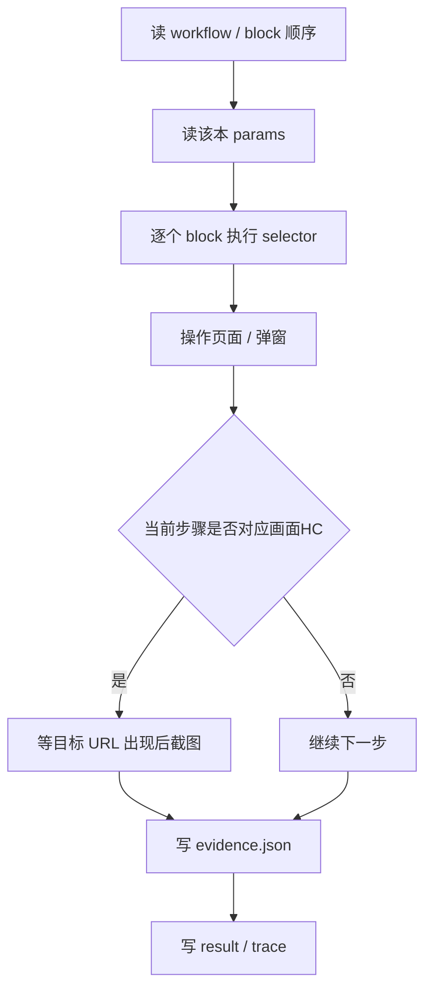

# 测试逻辑（TEST-LOGIC）

更新: 2026-10-27

这份文档回答三个问题：

1. 这个仓里的“测试”到底在测什么？
2. 一次执行是怎么从手顺走到截图的？
3. 怎么判断结果是真通过、只是流程通过、还是需要人工？

---

## 1. 目标与非目标

### 目标

- 用浏览器按手顺顺序操作 SUT / mock。
- 每个 `画面HC` 行在目标画面出现后截图。
- 记录每个检查点的期望值、实际值、URL、截图。
- 把人工项、非浏览器项、参数缺失项显式暴露出来。

### 非目标

- **不是**“450 本全部纯自动”。有些步骤天然需要人：
  - F12 / 開発者ツール改值
  - JP1 批处理、Shell、1 小时等待
  - APログ / DBログ / テーブル / DBダンプ
  - 外部认证、邮件、PDF 下载、OS 保存对话框
- **不是**真机验证。mock 通过 ≠ 公司机通过。
- **不是**参数正确性证明。mock 后端是静态的，不校验主档/DB。

---

## 2. 四层结论

| 层 | 回答的问题 | 当前证据 |
|---|---|---|
| Flow | 按钮、页面跳转、弹窗流程能不能走通？ | `logs/<case>/<case>-node-result.json` |
| Evidence | 每个 `画面HC` 行有没有截图？截图在不在目标画面？ | `logs/<case>/<case>-evidence.json` |
| Params | 别纸的输入值是否真的写进 params？ | `logs/param-audit.json` / `PARAM-AUDIT.md` |
| Live | 公司机真实 SUT 是否通过？ | 目前 **0 本**，还没有真机结果 |

**只有四层都通过，才是真正可交付。现在只完成了 Flow + Evidence（mock）。**

---

## 3. 文件地图

| 文件 | 作用 |
|---|---|
| `workflow/workflow-<case>.json` | 手顺原始行 |
| `v2/data/cases/*.js` | 手顺 + 别纸（操作内容/表示内容） |
| `automation/blocks/blocks.json` | block 定义与组合 |
| `automation/node-runner/block-selectors*.json` | 每个 block 的浏览器步骤 |
| `automation/cdp/params/*.json` | 每本的执行参数 |
| `automation/cdp/params/param-map.json` | 别纸项目 → params key / 代码映射 |
| `automation/node-runner/runner.mjs` | 执行器 |
| `automation/node-runner/mock-src/` | 假页面 |
| `automation/node-runner/mock-server.mjs` | 假后端 |
| `logs/<case>/` | 截图、evidence、trace、result |
| `logs/PARAM-AUDIT.md` | 别纸值 vs params 对账 |
| `logs/AUTOMATION-ASSESSMENT.md` | 自动化质量评估 |

---

## 4. 一次执行的顺序



### 关键点

1. **block 顺序来自 `blocks.json workflows`**，按整本组合顺序执行。
2. **params 优先级**：`generated.json`（别纸生成） > case 专属文件 > `auto.json` 兜底。
3. **截图时机**：不是“每块截一张”，而是按 `case-evidence.json` 的 `画面HC` 行，等目标画面 URL 匹配后再截。
4. **DevTools / APログ等**：标 `manual`，不产假截图。

---

## 5. Block 是什么

一个 block 是一段固定操作：

```json
{
  "screen": "AZG100",
  "cases": ["AZ-110-01-009"],
  "steps": [
    { "action": "click", "selector": "#act001to100" },
    { "action": "assert", "assert": "visible", "selector": "#policy_number" }
  ]
}
```

- `selector` 是页面控件定位。
- `value` 可以是 `params.xxx`，运行时替换。
- `force` 用于 `visibility:hidden` / disabled 的控件。
- `popup` 用于新窗口。
- `manual` 表示该步骤本身不可自动，只记录 note。
- `note` 里出现 `非浏览器` / `真機` / `mock` / `簡易` 的步骤是**代理步骤**，不能当成真实校验。

---

## 6. 别纸与 params 的正确关系

```text
别纸「操作内容」 → param-map → 该本 params → block → runner
```

例：`AZ-110-01-009`

| 层 | 值 |
|---|---|
| 别纸 | 入力区分 = 現地 |
| param-map | 入力区分 → inputType，代码 2 = 現地 |
| params | `inputType: "2"` |
| block | 选 `params.inputType` |
| runner | `selectOption("2")` |
| 页面 | `<option value="2">現地</option>` |

### 当前设计债：`auto.json`

`auto.json` 是“450 本通用默认值”，本来只是临时脚手架。

问题：

- 它包含业务值（証券番号、種目、保険種類等）。
- 现在仍有 56 本以它为主要来源；其中 40 本的 block 实际引用业务参数，别纸「操作内容」抽不到值。
- mock 不校验主档，所以仍显示 pass。
- `--strict-params` 已实现：block 引用的参数如果只来自 `auto.json`，runner 直接退出 3。

**正确目标：**

- 业务值全部来自该本别纸，写入该本 params。
- `auto.json` 只保留技术默认值（startUrl、startSelector 等），或者完全移除。
- 缺少业务参数时 runner 应失败，而不是默默用默认值。
- 剩余 48 本 C 类清单见 `logs/PARAM-REVIEW.md`：8 本手顺内多值，40 本 auto-only 但引用业务参数。

---

## 7. 什么算 pass

| 状态 | 含义 |
|---|---|
| `DONE` / `status: pass` | 所有 block 执行完，且没有 skipped |
| `PARTIAL` | 有 block 没有 selector，未执行 |
| `FAIL` | 某个 selector/断言/页面操作失败 |
| `exact` evidence | 在对应 `画面HC` 行、目标 URL 截图 |
| `manual` | 人工确认项，没有截图 |
| `missing` | 应该有截图但没有 |
| param `一致` | 别纸值 = params 值 |
| param `不一致` | 别纸值 ≠ params 值 |
| param `params未設定` | 别纸有值，params 没有 key |
| param `規則/自動` | 别纸写的是规则值（システム日+7日等），不能字面比较 |

**注意：`status: pass` 只代表 flow pass。**  
必须同时看 evidence、param audit，才能说这本“可交付”。

---

## 8. 怎么观察一次测试

### 1) 可见窗口 + 慢速

```bash
cd D:/Code/ms-ad/automation/node-runner
node mock-server.mjs 10091
```

另开终端：

```bash
node runner.mjs --case AY-120-09-007 --base-url http://127.0.0.1:10091/ --headed --edge --slow 1500 --keep-open 300000
```

你会看到 Edge 窗口逐步操作，最后停留 5 分钟。

### 2) 单步 trace

```bash
node runner.mjs --case AY-120-09-007 --base-url http://127.0.0.1:10091/ --trace
```

输出：

```text
logs/AY-120-09-007/AY-120-09-007-trace.json
logs/AY-120-09-007/AY-120-09-007-trace.html
```

`trace.html` 每个步骤一行：block、event、action、selector、URL、截图。  
可以直接在浏览器打开，逐步看“它到底做了什么、看到什么”。

### 3) 严格参数模式

```bash
node runner.mjs --case AY-120-02-015 --base-url http://127.0.0.1:10091/ --strict-params
```

如果 block 引用的业务参数只来自 `auto.json`，会直接退出：

```text
STRICT PARAMS: customerName<-auto.json, sectionCode<-auto.json
```

这样就不会再把占位值当成已落实别纸。

### 4) 現場用 作業シート（公司 PC 用）

```text
http://127.0.0.1:10092/v2/ops/index.html
```

- 450 本各自一页 A4，无 block/selector/params 术语。
- 第一眼：A/B/C/D 大判定 + “最初にやること”。
- 下面：実行コマンド（A/B のみ）、手作業チェック、入力値、画面HC、OK/NG 判定栏。
- 浏览器直接打印即可；C/D 不显示执行命令，只显示“不要执行”。

### 5) 「手作業」与「mock 代替」的判定

作业单不再把所有带 `mock/真機` 的步骤都叫“手作業”。现在分三类：

| 类型 | 来源 | 含义 |
|---|---|---|
| 手順人工 | `evidence.manualSteps`（手顺行） | **唯一的人工判断源**：手顺书明确要求人做的操作/确认（F12、JP1、APログ、DB、テーブル等） |
| 手順外 block 人工 | block step 的 `action: manual` 或 note 明确“非浏览器/真機人工” | 实现层不能自动，但手顺没有列；只作为 block 质量警告，**不计入作业单人工数** |
| mock 代替 | block step 的 note 是 `mock回写/mock简化/mock无后端消息` 等 | mock 无法验证，但真机应由 runner 自动断言；不算手作業 |

判断标准：**手顺书是唯一业务真值源。手顺说人做才算人工；block 不能自己增加人工项。**

`node runner.mjs ... --live` 时，mock 代替的 assert 会真正执行；mock 运行时才跳过。

例：`AZ-110-01-009`

- 手順人工：**0 件**
- mock 代替：**3 件**（保険種類反映、募集人 opener 回写、`MAZG101W047` 消息）
- 以前把后 3 件算成“手作業 3 件”是错的；现在作业单显示“手作業 0 / mock 3”。

### 6) 自动化诊断页面

```text
http://127.0.0.1:10092/v2/index.html#/automation
```

一页一本书：

- 列表直接显示 A/B/C/D、flow、証跡 exact/HC、人工数、代理 block 数、参数状态。
- 点一本书进入详情：
  - 顶部四格：Flow / 証跡 / 人工·代理 step / Params
  - block 顺序：每个 block 的品质（browser / proxy / proxy-only / manual）、行号、画面迁移
  - 展开 block：每个 step 的 action / selector / note，人工和代理 step 高亮
  - 人工看什么：手顺人工项 + block 内的代理/人工 step
  - 别纸参数：别纸值 vs params，一致/複数値/auto 标记
  - 画面HC：exact/manual/missing 与截图链接

这样不用再靠“看一堆 block 表猜这本书是什么情况”。

### 7) 结果文件

```text
logs/<case>/<case>-node-result.json   flow 结果
logs/<case>/<case>-evidence.json      画面HC 截图与 URL
logs/<case>/<case>-trace.html         单步 trace
```

### 8) 全局审计

```text
logs/PARAM-AUDIT.md                别纸 vs params
logs/PARAM-REVIEW.md               C 类参数残作业
logs/FEASIBILITY.md                A/B/C/D 分类
logs/A-CASES.txt                   可直接真机的 A 类清单
logs/BLOCK-QUALITY.md              block 代理/人工清单
logs/AUTOMATION-ASSESSMENT.md      block/人工/参数质量
logs/PARAMS-COVERAGE.md            auto-only 本清单
```

---

## 9. 当前诚实评估

来自 `logs/AUTOMATION-ASSESSMENT.md`：

| 指标 | 数量 |
|---|---:|
| block 总数 | 252 |
| block 步骤 | 1608 |
| 含代理/非浏览器 note 的步骤 | 275 |
| 含代理步骤的 block | 149 |
| 含人工步骤的本 | 224 |
| 别纸参数要人工确认（不一致/缺失/複数値）的本 | 8 |
| 无人工步骤、无代理、参数干净的本 | **28** |
| 当前 mock flow 通过 | 446 / 450 |

结论：

- 446/450 是 **mock flow pass**；4 本因别纸值与业务校验规则冲突，故意不强行跑绿。
- 149 个 block 含代理步骤，不是纯浏览器验证。
- 224 本至少有一个手顺步骤需要人。
- 8 本别纸同一项目有多个值，单一 params 不能表达整条手顺。
- 真正“流程 + 参数 + 无代理”都干净的是 28 本。
- 4 本规则冲突：`AZ-110-01-011` / `AZ-110-01-012` / `AZ-310-01-011` / `AZ-310-01-012`。别纸写「入力区分 現地 + 種目 種目共通」，但业务校验要求種目共通只能用「機械 / 機械(他)」；旧 params 用 5 强行跑绿，现在不这么做。

---

## 10. 自动化可行性分类

| 类型 | 定义 | 处理 |
|---|---|---|
| A 全自动 | 无人工步骤、无代理 block、参数一致 | 可以真机直接跑 |
| B 自动+人工/代理 | 浏览器流程可跑，但有人工步骤或代理 block | 自动跑流程，人工补证据 |
| C 参数待修 | 参数未落实、auto-only、或手顺内多值 | 先修参数，再跑 |
| D 阻塞 | mock flow 失败（含业务规则冲突） | 人工定位后重跑 |

当前：A 29 / B 369 / C 48 / D 4。只有 A 类可以直接进真机；A 类清单见 `logs/A-CASES.txt`。

---

## 11. 下一步（按优先级）

1. **参数重构**
   - 从别纸生成每本 params
   - `auto.json` 只保留技术默认
   - 缺业务参数直接失败，不再兜底
2. **Block 质量审查**
   - 149 个含代理步骤的 block 已在 `logs/BLOCK-QUALITY.md` 逐个列出
   - 123 个“浏览器+代理”、23 个“纯代理”、3 个“人工”；下一步逐个删假断言
3. **可行性分类**
   - 已给 450 本打 A/B/C/D 标签：`logs/FEASIBILITY.md`
   - 前端 `#/feasibility` 已可按标签过滤
4. **真机验证**
   - 只对 A 类先跑
   - B/C 类按人工 checklist 执行

---

## 12. 设计原则

- 别纸是唯一业务真值源。
- block 只描述操作，不写死业务值。
- params 是执行绑定，不应有通用业务默认。
- 不能自动的步骤必须显式标 manual，不允许用假截图/假断言换绿。
- `pass` 必须按 flow / evidence / params / live 分开显示。
