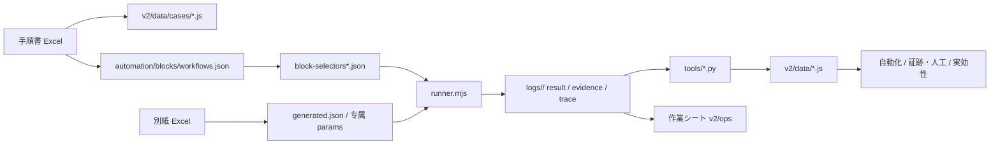

# 项目使用说明（给负责人）

更新: 2026-10-25

> 这份文档只回答一件事：**现在这个项目怎么用，页面和名词是什么意思。**
> 工程细节、重建计划、审查标准在别的文档里；你日常不需要看。

---

## 0. 一句话

日常只看三个地方：

| 场景 | 打开 | 用途 |
|---|---|---|
| 办公室看单本 | `v2/index.html#/automation` | 这本书是什么情况、哪里要人、参数对不对 |
| 公司电脑执行 | `v2/ops/index.html` | 一本一页 A4 作业单，照着做 |
| 看证据/人工 | `v2/index.html#/manual` | 哪些画面HC 已取得、哪些要人工 |

其他页面是辅助，**不需要从 dashboard 开始一本本点**。

---

## 1. 推荐使用流程

### 1.1 办公室：先判断这本书能不能跑

1. 打开：

```text
http://127.0.0.1:10092/v2/index.html#/automation
```

2. 搜索 case ID，例如 `AZ-110-01-009`。
3. 先看四个东西：

```text
A/B/C/D  → 这本书的处理方式
flow     → mock 流程有没有跑通
人工     → 手顺要求人做几件
mock     → 几件是 mock 不能验证、真机要自动断言
```

4. 点进去，看：
   - block 顺序
   - 每一步是 browser / manual / mock
   - “人がやる項目”
   - “mockでは確認できない項目”
   - 别纸参数是否一致

5. 点「作業シート」，得到公司电脑用的一页纸。

### 1.2 公司电脑：照着作业单做

打开：

```text
http://127.0.0.1:10092/v2/ops/index.html
```

- **A 全自動**：执行命令 → 看画面HC → 判定栏打勾。
- **B 自動 + 実機確認**：执行命令 → 做“手作業” → 看“mock 不能确认”的项目。
- **C 実行前に確認**：不要执行；先确认黄色输入值。
- **D 業務確認待ち**：不要执行；先找业务确认规则冲突。

C/D 的作业单**不显示执行命令**，避免误跑。

### 1.3 跑完：看证据

打开：

```text
http://127.0.0.1:10092/v2/index.html#/manual
```

看：

- 画面HC 已取得多少
- 哪些 missing
- 哪些是人工
- 参数是否还有 auto

---

## 2. 前端页面逐页说明

左侧菜单现在有这些。**加粗**的是你日常要用的。

| 菜单 | 作用 | 什么时候用 |
|---|---|---|
| ダッシュボード | 总览 KPI、分类统计 | 只看总量时 |
| シナリオ | 场景一览、场景下的 case | 想按场景找书时 |
| 実施順序 | 业务路由/顺序 | 想看先做哪本时 |
| ファイル | 按目录树列 case | 想按文件结构找书时 |
| 自分のタスク | 你导入的任务清单 | 只做自己被分配的书时 |
| 日程 | 排期 | 看时间安排时 |
| 参考資料 | 状态迁移、ToDo、时区、用户表 | 查业务参考时 |
| **自動化** | 单本诊断：A/B/C/D、block、人工、参数 | **办公室最常用** |
| **作業シート** | 450 本一页纸作业单 | **公司电脑最常用** |
| **証跡・人工** | 画面HC、人工项、参数审计 | 跑完看证据时 |
| 実効性 | A/B/C/D 总表 | 想看整体分布时 |

### 2.1 自動化（单本诊断）

列表每行：

```text
case ID / 功能名
判定（A/B/C/D）+ 理由
flow pass/fail
証跡 exact/HC
人工数
代理 block 数
参数状态
下一步
```

点进去：

```text
顶部四格：Flow / 証跡 / 人工 / Params
block 顺序：每个 block 的品质、行号、画面迁移
展开 block：每一步的 action / selector / note
人がやる項目
mockでは確認できない項目
别纸参数
画面HC
```

### 2.2 作業シート（公司电脑）

一本一页 A4，第一眼只有：

```text
A/B/C/D 大判定
最初にやること
手作業 N 件
mock では確認できない項目 N 件
入力値
画面HC
OK/NG 判定栏
```

没有 block、selector、params 这些工程词。

### 2.3 証跡・人工

一张表看所有书：

```text
実行 / パラメータ / 別紙照合
画面HC / 自動 / 近似 / 人工 / 未取得
人工操作 / 人工确认
```

筛选：

- 画面HC人工あり
- 人工操作あり
- 証跡未取得
- 自動のみ
- 既定値 params
- 別紙不一致

### 2.4 実効性

A/B/C/D 总表。用来回答：

```text
哪些书可以真机直接跑？
哪些书要人工？
哪些书参数没落实？
哪些书规则冲突？
```

日常单本还是去「自動化」，不要在这里逐本点。

---

## 3. 名词表

### 3.1 测试资产

| 名词 | 意思 |
|---|---|
| 手順書 | 每本书的操作步骤 Excel。测试的源头。 |
| 別紙 | 手顺书附带的输入值/显示值表。业务参数的真值源。 |
| 画面HC | 手顺里要求截图的确认行（画面确认）。 |
| evidence | 证据。包括截图、URL、行号、状态。 |
| trace | 单步追踪。每个 step 执行后的截图 + action + selector + URL。 |
| mock | 源码模拟环境。不是真实 SUT。 |
| live / 真機 | 公司实际系统。 |

### 3.2 自动化

| 名词 | 意思 |
|---|---|
| block | 一段固定操作。比如“打开菜单 → 输入 → 确认”。 |
| step | block 里的一步。click / fill / assert / popup / manual。 |
| selector | 页面上某个控件的定位。工程用，现场不用看。 |
| params | 这本书执行时使用的输入值。 |
| runner | 执行 block 的 Node 脚本。 |
| auto.json | 通用兜底参数。现在仍有 56 本依赖它。 |
| generated.json | 从别纸生成的参数。优先于 auto。 |
| proxy | 代理步骤。用别的画面/控件代替真实确认。 |
| proxy-only | 整个 block 只有代理步骤，没有真浏览器动作。 |
| mock-only | mock 做不到、但真机应由 runner 自动断言的步骤。**不是人工。** |
| manual | 手顺要求人做的步骤。 |

### 3.3 判定

| 名词 | 意思 |
|---|---|
| flow | 流程能不能走完。 |
| evidence pass | 截图/URL 是否拿到。 |
| params pass | 别纸值和执行值是否一致。 |
| live pass | 真机是否通过。 |
| A 全自動 | 无人工、无代理 block、参数干净。 |
| B 自動+実機確認 | 流程能跑，但有 mock 代替或人工步骤。 |
| C 参数待修 | 参数未落实、auto-only、或手顺内多值。 |
| D 阻塞 | mock flow 失败，通常是业务规则冲突。 |

### 3.4 状态

| 名词 | 意思 |
|---|---|
| exact | 画面HC 截图已取得，且 URL/画面匹配。 |
| manual | 该行本来就是人工确认，没有截图。 |
| missing | 应该有截图但没拿到。 |
| match | 别纸值和 params 一致。 |
| rule | 别纸写的是规则/自动值，不直接比较。 |
| multiValue | 同一项目在手顺中有多个值，单一 params 表达不了。 |
| mismatch | 别纸值和 params 不一致。 |
| auto | params 只来自 auto.json。 |

### 3.5 报告

| 文件 | 看什么 |
|---|---|
| `logs/FEASIBILITY.md` | A/B/C/D 分类 |
| `logs/A-CASES.txt` | 可直接真机的 29 本 |
| `logs/BLOCK-QUALITY.md` | 252 个 block 的品质 |
| `logs/PARAM-AUDIT.md` | 别纸 vs params |
| `logs/PARAM-REVIEW.md` | 剩余参数作业 |
| `logs/MOCK-CONFORMANCE.md` | mock 环境符合性评估 |
| `logs/MANUAL-CHECKLIST.md` | 人工确认清单 |

---

## 4. 徽章图鉴

### 4.1 分类徽章

| 徽章 | 颜色 | 意思 |
|---|---|---|
| A 全自動 | 绿 | 真机可以直接跑 |
| B 自動+実機確認 | 蓝 | 自动跑 + 实机确认 |
| C 実行前に確認 | 黄 | 先确认参数，不要直接跑 |
| D 業務確認待ち | 红 | 规则冲突，先找业务 |

### 4.2 参数徽章

| 徽章 | 意思 |
|---|---|
| 固有 params | 有专属参数文件 |
| 既定値 | 只来自 auto.json，业务值未确认 |
| 一致 | 别纸值 = 执行值 |
| 規則/自動 | 别纸写的是规则或系统自动值 |
| 複数値 | 同一项目有多个值 |
| 不一致 | 别纸值 ≠ 执行值 |

### 4.3 证据徽章

| 徽章 | 意思 |
|---|---|
| exact | 截图已取得且匹配 |
| manual | 人工确认，无截图 |
| missing | 应有截图但没拿到 |
| mock pass | mock 流程通过，不是真机 |
| NG n | n 个参数/证据问题 |

### 4.4 自动化徽章

| 徽章 | 意思 |
|---|---|
| browser | 纯浏览器 block |
| proxy | 含代理步骤的 block |
| proxy-only | 只有代理步骤，无真浏览器动作 |
| manual | 人工 block |
| 検証済 | 真机通过 |
| 実装済 | mock 通过，真机未 |
| 未着手 | 还没有实现 |
| mock-verified | mock 已验证 |
| live-verified | 真机已验证 |

### 4.5 状态徽章

| 徽章 | 意思 |
|---|---|
| 未実施 | 没开始 |
| 実施中 | 进行中 |
| 実施完了 | 做完了 |
| 検証完了 | 已复核 |
| 不可 | 阻塞 |
| OK / NG | 结果 |

### 4.6 其他

| 徽章 | 意思 |
|---|---|
| 手順書なし | 没有手顺书 |
| 別紙なし | 没有别纸 |
| 旧版 | 旧版本 |
| 現新比較 | 新旧对比对象 |
| 自分のタスク | 已加入自己的任务 |
| 自動化 N | 有 N 个自动化定位 |

---

## 5. 数据流



### 5.1 每一段是什么

| 层 | 文件 | 说明 |
|---|---|---|
| 原始规格 | Excel | 手顺书 + 别纸 |
| 查看数据 | `v2/data/cases/*.js` | 前端用的 case/手顺/别纸数据 |
| 流程组合 | `automation/blocks/workflows.json` | 一本书由哪些 block 组成 |
| 操作实现 | `block-selectors*.json` | block 里的 click/fill/assert |
| 参数 | `automation/cdp/params/*.json` | 执行输入值 |
| 执行 | `runner.mjs` | 跑 mock 或真机 |
| 结果 | `logs/<case>/` | result / evidence / trace / 截图 |
| 汇总 | `tools/*.py` | 生成前端数据与报告 |
| 页面 | `v2/` | 给人看的 UI |
| 作业单 | `v2/ops/` | 公司电脑用 A4 |

### 5.2 最重要的一句话

**手顺书是业务真值源。block 和 mock 都是实现，不是真值源。**

---

## 6. 当前状态（必须知道）

```text
450 本
446 mock flow pass
4 本故意失败（业务规则冲突）
```

4 本：

```text
AZ-110-01-011
AZ-110-01-012
AZ-310-01-011
AZ-310-01-012
```

分类：

```text
A 29
B 369
C 48
D 4
```

自动化质量：

```text
149 个 block 含代理步骤
23 个 block 是纯代理
98 本至少用了 1 个纯代理 block
6 本全部 block 都是纯代理
245 本 / 415 个 step 是 mock 代替
```

证据：

```text
画面HC 3034
exact 2972
manual 22
missing 40（全部在 4 本失败本）
```

参数：

```text
1424 个对照项
1265 一致
151 规则/自动
8 手顺内多值
56 本 auto-only
40 本 auto-only 但 block 实际引用业务参数
```

### 不要误解

- `446/450` 不是真机通过率。
- `mock pass` 不是业务正确。
- `B` 不是失败，是“自动 + 实机确认”。
- `0 人工` 不代表没有 mock 代替；009 就是这样。
- 4 本失败不是环境崩溃，是别纸和 mock 规则冲突。

---

## 7. 常见问题

### Q1. 为什么 A 只有 29 本？

A 要求：无人工 + 无代理 block + 参数干净。  
大量书有 batch/APログ/代理步骤，所以是 B。

### Q2. 为什么 009 显示 0 人工，但有 3 个 mock？

009 手顺没有人工行。  
3 个是 mock 不能验证、真机 `--live` 自动断言的步骤，不是人要做的事。

### Q3. 为什么 C/D 作业单没有执行命令？

C 参数未确认，D 规则冲突。  
先确认，不要跑。

### Q4. 为什么 4 本故意失败？

别纸写“現地 + 種目共通”，mock 校验要求“機械/機械(他)”。  
不知道哪边对，所以不强行改绿。

### Q5. 公司电脑要带什么？

要连截图一起看：

```text
整个仓库
或 v2/ops + logs
```

只带 `v2/ops`，文字和 checklist 能看，图片链接会断。

### Q6. trace 怎么开？

```bash
node runner.mjs --case AZ-110-01-009 \
  --base-url <URL> --trace
```

生成：

```text
logs/<case>/<case>-trace.json
logs/<case>/<case>-trace.html
```

每个 step 一张执行后截图。

### Q7. 我该改哪里？

- 业务值：别纸 / params
- 操作步骤：block-selectors
- 页面数据：跑 `tools/*.py` 重新生成，不要手改 `v2/data`
- 作业单：跑 `python tools/build_ops_sheets.py`

---

## 8. 启动与端口

### 只看页面/作业单

```bash
cd D:/Code/ms-ad
python -m http.server 10092
```

打开：

```text
http://127.0.0.1:10092/v2/index.html
```

### 要跑 mock

另开终端：

```bash
cd D:/Code/ms-ad/automation/node-runner
node mock-server.mjs 10091
```

如果 10091 已经在跑，不要重复启动。

### 端口

| 端口 | 用途 |
|---|---|
| 10092 | 查看器 + 作业单 |
| 10091 | mock 环境 |

公司真机不需要这两个端口；作业单里的命令直接指向公司 SUT URL。

---

## 9. 最小记忆

1. 办公室看 `#/automation`，公司电脑看 `#/ops`，证据看 `#/manual`。
2. A 直接跑；B 跑完做人工；C 先确认参数；D 先找业务。
3. 手顺书是唯一真值源；block 和 mock 只是实现。
4. mock pass 不是真机 pass。
5. 0 人工不等于没有 mock 代替。
