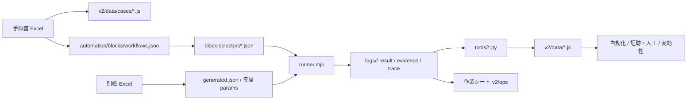

# 使用说明书（操作手册）

更新: 2026-10-25  
适用: `D:/Code/ms-ad`  
读者: 项目负责人 / 现场执行者 / 需要查证据的人

---

## 目录

1. [先看这一页](#1-先看这一页)
2. [第一次使用：5 分钟跑起来](#2-第一次使用5-分钟跑起来)
3. [每天怎么用：办公室判断一本书](#3-每天怎么用办公室判断一本书)
4. [公司电脑怎么用：作业单](#4-公司电脑怎么用作业单)
5. [怎么跑一本书（mock / 真机 / trace）](#5-怎么跑一本书mock--真机--trace)
6. [怎么跑 450 本](#6-怎么跑-450-本)
7. [怎么看证据](#7-怎么看证据)
8. [页面逐页说明](#8-页面逐页说明)
9. [徽章图鉴](#9-徽章图鉴)
10. [名词表](#10-名词表)
11. [数据流与文件地图](#11-数据流与文件地图)
12. [故障排查](#12-故障排查)
13. [常用命令速查](#13-常用命令速查)
14. [当前状态与不要误解的事](#14-当前状态与不要误解的事)

---

## 1. 先看这一页

你日常只需要三个入口：

| 你要做什么 | 打开 | 记住 |
|---|---|---|
| 办公室判断一本书 | `v2/index.html#/automation` | 看 A/B/C/D、人工、mock、参数 |
| 公司电脑执行 | `v2/ops/index.html` | 一本一页，照着做 |
| 看证据/人工 | `v2/index.html#/manual` | 哪些截图有、哪些缺 |

一句话流程：

```text
办公室看「自動化」→ 打开「作業シート」→ 公司电脑执行 → 回来看「証跡・人工」
```

A/B/C/D 的含义：

```text
A 全自動        → 真机直接跑
B 自動+実機確認 → 跑完做人工/实机确认
C 実行前に確認  → 先确认参数，不要直接跑
D 業務確認待ち  → 规则冲突，先找业务
```

> 重要：`mock pass` 不是真机 pass。  
> 重要：`0 人工` 不代表没有 mock 代替。  
> 重要：手顺书是唯一业务真值源，block 和 mock 只是实现。

---

## 2. 第一次使用：5 分钟跑起来

### 2.1 需要什么

- Windows
- Python（启动查看器）
- Node.js（跑 runner / mock）
- Microsoft Edge（真机或可见窗口）
- 整个仓库（不要只拷 `v2/ops`，否则截图链接会断）

### 2.2 启动查看器

打开 PowerShell 或 CMD：

```bash
cd D:/Code/ms-ad
python -m http.server 10092
```

看到：

```text
Serving HTTP on :: port 10092 ...
```

浏览器打开：

```text
http://127.0.0.1:10092/v2/index.html
```

如果 10092 被占用，换一个端口：

```bash
python -m http.server 10093
```

然后访问：

```text
http://127.0.0.1:10093/v2/index.html
```

### 2.3 启动 mock（只有跑 mock 才需要）

另开一个终端：

```bash
cd D:/Code/ms-ad/automation/node-runner
node mock-server.mjs 10091
```

看到：

```text
mock-src server on http://127.0.0.1:10091/
```

如果 10091 已经在跑，不要重复启动。

### 2.4 验证是否正常

打开：

```text
http://127.0.0.1:10092/v2/index.html#/automation
```

应该看到：

```text
自動化診断
450 件
A 29 / B 369 / C 48 / D 4
```

如果看不到，先看 [故障排查](#12-故障排查)。

---

## 3. 每天怎么用：办公室判断一本书

### 3.1 打开单本诊断

```text
http://127.0.0.1:10092/v2/index.html#/automation
```

在搜索框输入：

```text
AZ-110-01-009
```

### 3.2 先看这一行的 6 个信息

| 列 | 你要看什么 |
|---|---|
| 判定 | A / B / C / D + 理由 |
| flow | pass / fail |
| 証跡 | exact/HC，例如 `17/17` |
| 人工 | 手顺要求人做几件 |
| 代理block | 几个 block 含代理 |
| 参数 | 一致 / 複数値 / auto / NG |

例：

```text
AZ-110-01-009
B 自動 + 実機確認
flow pass
証跡 17/17
人工 0
代理block 3
参数 OK / generated.json
```

### 3.3 点进去看细节

点这一行，进入详情：

```text
#/automation/AZ-110-01-009
```

从上到下看：

1. **顶部四格**
   - Flow：流程是否 pass
   - 証跡：截图 exact/HC
   - 人工（手順）/ mock：人要做几件、mock 代替几件
   - Params：参数来源和问题

2. **block 順**
   - 每个 block 的品质：browser / proxy / proxy-only / manual
   - 行号范围
   - 画面迁移
   - 展开看每个 step

3. **人がやる項目**
   - 只来自手顺书的 `manualSteps`
   - 这里没有，就真的没有人工

4. **mockでは確認できない項目**
   - 真机加 `--live` 自动断言
   - 不是人要做的事
   - optional 会写“失败也不停止，必要时目视”

5. **別紙パラメータ**
   - 别纸值 → 执行值
   - 一致 / 複数値 / auto

6. **画面HC**
   - exact / manual / missing
   - 点“画像”看截图

### 3.4 打开作业单

详情页点：

```text
作業シート
```

会打开：

```text
v2/ops/<caseId>.html
```

也可以从左侧菜单「作業シート」进总表：

```text
v2/ops/index.html
```

### 3.5 用作业单决定去不去公司电脑

| 作业单顶部 | 动作 |
|---|---|
| A 全自動 | 去公司电脑跑 |
| B 自動+実機確認 | 去公司电脑跑，然后做人工/目视 |
| C 実行前に確認 | 不要去公司跑，先确认参数 |
| D 業務確認待ち | 不要跑，先找业务 |

---

## 4. 公司电脑怎么用：作业单

### 4.1 带什么去公司电脑

推荐：

```text
整个 D:/Code/ms-ad
```

至少：

```text
v2/ops
logs
```

只带 `v2/ops` 的话：

- 文字、清单、判定栏能看
- “画像”链接会断

### 4.2 打开作业单总表

在公司电脑启动查看器：

```bash
cd D:/Code/ms-ad
python -m http.server 10092
```

打开：

```text
http://127.0.0.1:10092/v2/ops/index.html
```

总表看：

```text
ケース / 判定 / 画面HC / 手作業 / missing / 開く
```

搜索框输入 case ID 或功能名。

### 4.3 一本作业单怎么读

以 `AZ-110-01-009` 为例：

```text
B 自動 + 実機確認
自動で実行し、mockで確認できない項目だけ実機で確認します。
実機確認 3 件（mock代替）

最初にやること
下のコマンドを実行する。手作業はありません。mockでは確認できない項目を確認する。
```

下面：

1. **実行コマンド**
   ```bash
   node runner.mjs --case AZ-110-01-009 \
     --base-url <会社SUTのURL> --live
   ```
   把 `<会社SUTのURL>` 换成实际 URL。

2. **手作業で確認（0 件）**
   009 是 0 件。
   如果显示 N 件，就按行号、项目、内容逐条做。

3. **mock では確認できない項目（3 件）**
   真机由 runner 自动断言。
   - 不是 optional：失败会让流程失败
   - 是 optional：失败只 WARN，必要时目视

4. **入力値**
   别纸值 → 执行值。
   黄色 `auto（未確認）` 要先确认。

5. **画面HC**
   行号、画面/项目、确认内容、状态、图片。
   missing 要补。

6. **判定栏**
   ```text
   □ OK  □ NG
   実施者 / 実施日 / NG内容 / 確認者
   ```

### 4.4 C/D 为什么没有命令

- C：参数未确认，跑了也没有意义。
- D：规则冲突，跑绿可能是假绿。

作业单会显示红色：

```text
この本は実行しないでください。
```

### 4.5 打印

浏览器 `Ctrl+P`：

- A4
- 每本自动分页
- 手作业、输入值、画面HC、判定栏保留

---

## 5. 怎么跑一本书（mock / 真机 / trace）

先进入 runner 目录：

```bash
cd D:/Code/ms-ad/automation/node-runner
```

### 5.1 跑 mock（最快）

```bash
node runner.mjs --case AZ-110-01-009 \
  --base-url http://127.0.0.1:10091/
```

输出：

```text
CASE AZ-110-01-009 | ...
PLAN 10 block(s)
...
DONE AZ-110-01-009 — 10/10 blocks, 28 shots in logs/AZ-110-01-009/
```

结果在：

```text
logs/AZ-110-01-009/AZ-110-01-009-node-result.json
```

### 5.2 跑真机

```bash
node runner.mjs --case AZ-110-01-009 \
  --base-url https://<公司SUT>/... \
  --live
```

`--live` 的作用：

- 真正执行 mock-only assert
- 真正的非浏览器步骤仍然只记 `MANUAL`
- 不会用假断言换绿

如果不加 `--live`，但 URL 不是 localhost，runner 也会自动按 live 处理。

### 5.3 可见窗口 + 慢速

```bash
node runner.mjs --case AZ-110-01-009 \
  --base-url http://127.0.0.1:10091/ \
  --headed --edge --slow 1500 --keep-open 300000
```

参数：

| 参数 | 作用 |
|---|---|
| `--headed` | 显示浏览器窗口 |
| `--edge` | 用 Edge |
| `--slow 1500` | 每步停 1.5 秒 |
| `--keep-open 300000` | 最后停留 5 分钟 |

适合演示、排查“它到底点了哪里”。

### 5.4 开 `--trace`：每一步截图

命令：

```bash
node runner.mjs --case AZ-110-01-009 \
  --base-url http://127.0.0.1:10091/ \
  --trace
```

生成：

```text
logs/AZ-110-01-009/AZ-110-01-009-trace.json
logs/AZ-110-01-009/AZ-110-01-009-trace.html
logs/AZ-110-01-009/trace_001_....png
logs/AZ-110-01-009/trace_002_....png
...
```

打开 HTML：

```text
D:/Code/ms-ad/logs/AZ-110-01-009/AZ-110-01-009-trace.html
```

表格列：

| 列 | 含义 |
|---|---|
| # | 第几步 |
| block | 属于哪个 block |
| event | 这一步在做什么 |
| action | click / fill / assert / popup / manual |
| selector | 点的/填的元素 |
| URL | 执行后的页面 URL |
| screenshot | 执行后的截图 |

实测 `AY-100-04-001`：

```text
1 goto   02_trace_001_goto_start_screen.png
2 fill   03_trace_002_input_ログイン.png
3 click  05_trace_003_click_ログイン.png
4 assert 07_trace_004_ast_遷移_システムエラー画面.png
5 assert 08_trace_005_ast_エラーメッセージ_MAZG000E001.png
```

注意：

- 截图是 **step 执行后**，不是执行前
- popup step 截 popup
- `manual` step 也截当前画面，但不证明人工完成
- mock-only assert 在 mock 下跳过，trace 仍截当前画面
- 加 `--live` 后才真正执行这些 assert
- 截图失败时 HTML 显示 `—`

### 5.5 严格参数模式

```bash
node runner.mjs --case AY-120-02-015 \
  --base-url http://127.0.0.1:10091/ \
  --strict-params
```

如果 block 用的业务参数只来自 `auto.json`：

```text
STRICT PARAMS: customerName<-auto.json, sectionCode<-auto.json
```

进程退出码 3。  
这是故意的：不要把占位值当已确认。

### 5.6 结果文件说明

每本书目录：

```text
logs/<caseId>/
  <caseId>-node-result.json   执行结果
  <caseId>-evidence.json      画面HC 证据
  <caseId>-trace.json         单步 trace（只有 --trace）
  <caseId>-trace.html         单步 trace 页面
  01_....png                  截图
```

---

## 6. 怎么跑 450 本

### 6.1 命令

```bash
cd D:/Code/ms-ad
node tools/run_all.mjs \
  --base http://127.0.0.1:10091/ \
  --jobs 6 \
  --timeout 180
```

输出：

```text
DONE total=450 pass=446 partial=0 fail=4 unknown=0
```

### 6.2 跑完看哪里

```text
logs/run-all-summary.json
logs/AUTOMATION-ASSESSMENT.md
logs/FEASIBILITY.md
logs/PARAM-AUDIT.md
```

### 6.3 不要把 446 当全绿

4 本故意失败：

```text
AZ-110-01-011
AZ-110-01-012
AZ-310-01-011
AZ-310-01-012
```

原因：别纸值 vs 业务校验规则冲突。  
不要为了全绿改别纸或改参数。

---

## 7. 怎么看证据

### 7.1 「証跡・人工」页面

```text
http://127.0.0.1:10092/v2/index.html#/manual
```

表格列：

| 列 | 含义 |
|---|---|
| 実行 | mock pass / fail |
| パラメータ | 固有 / 既定値 |
| 別紙照合 | 一致 / NG / 未抽出 |
| 画面HC | 应有截图数 |
| 自動 | 自动取得数 |
| 近似 | 代理/近似数 |
| HC人工 | 人工确认数 |
| 未取得 | missing 数 |
| 人工操作 | 手顺要求人操作的数 |
| 人工確認 | 手顺要求人确认的数 |

筛选：

```text
画面HC人工あり
人工操作あり
証跡未取得
自動のみ
既定値 params
別紙不一致
```

### 7.2 单本证据

在「自動化」详情最下面：

```text
画面HC（17 行 / missing 0）
```

每行：

```text
行号 / 画面项目 / 确认内容 / exact|manual|missing / 画像
```

### 7.3 证据状态

| 状态 | 意思 |
|---|---|
| exact | 截图已取得，URL/画面匹配 |
| manual | 该行是人工确认，无截图 |
| missing | 应有截图但没拿到 |
| blockEnd | 只在 block 结尾取到 |
| unmapped | 有截图但没有独立 URL 规则 |

---

## 8. 页面逐页说明

### 8.1 ダッシュボード

看总量：

- 总 case
- 实施情况
- 验证情况
- NG
- 数据缺失

日常不需要从这里开始。

### 8.2 シナリオ

按场景分组看 case。

- 点场景看标题、视角、flow
- 点 case 打开抽屉
- 抽屉里有手顺、别纸、检查模式

什么时候用：想按业务场景找书。

### 8.3 実施順序

看业务路由：

```text
先做哪本 → 再做哪本
```

什么时候用：需要按顺序执行一组书。

### 8.4 ファイル

按目录树列 case：

```text
category → scenario → case
```

什么时候用：知道文件结构，想按结构找。

### 8.5 自分のタスク

你导入的任务清单。

- 可以粘贴 case ID
- 可以清空
- 可以看任务对应的 route

什么时候用：只做自己被分配的书。

### 8.6 日程

排期表。

什么时候用：看时间安排。

### 8.7 参考資料

- 状态迁移
- ToDo 模式
- 时区
- 用户表

什么时候用：查业务参考，不参与执行。

### 8.8 自動化（重点）

单本诊断。

列表：

```text
case / 判定 / flow / 証跡 / 人工 / 代理block / 参数 / 下一步
```

详情：

```text
四格 → block 顺序 → 人工 → mock 代替 → 参数 → 画面HC
```

什么时候用：办公室判断一本书。

### 8.9 作業シート（重点）

450 本一页纸。

- 公司电脑执行用
- 可打印
- C/D 不显示命令
- 有判定栏

什么时候用：去公司电脑前。

### 8.10 証跡・人工（重点）

所有书的证据/人工总表。

什么时候用：跑完看缺什么。

### 8.11 実効性

A/B/C/D 总表。

什么时候用：看整体分布，不逐本操作。

---

## 9. 徽章图鉴

### 9.1 分类

| 徽章 | 颜色 | 含义 |
|---|---|---|
| A 全自動 | 绿 | 真机直接跑 |
| B 自動+実機確認 | 蓝 | 跑完做人工/实机确认 |
| C 実行前に確認 | 黄 | 先确认参数 |
| D 業務確認待ち | 红 | 规则冲突 |

### 9.2 参数

| 徽章 | 含义 |
|---|---|
| 固有 params | 有专属参数文件 |
| 既定値 | 只来自 auto.json |
| 一致 | 别纸值 = 执行值 |
| 規則/自動 | 别纸是规则或系统自动值 |
| 複数値 | 手顺内有多个值 |
| 不一致 | 别纸值 ≠ 执行值 |
| auto（未確認） | 作业单里的黄色提示 |

### 9.3 证据

| 徽章 | 含义 |
|---|---|
| exact | 截图取得且匹配 |
| manual | 人工确认 |
| missing | 应有截图但没拿到 |
| mock pass | mock 通过，不是真机 |
| NG n | n 个问题 |

### 9.4 自动化

| 徽章 | 含义 |
|---|---|
| browser | 纯浏览器 block |
| proxy | 含代理步骤 |
| proxy-only | 纯代理，无真浏览器动作 |
| manual | 人工 block |
| 検証済 | 真机通过 |
| 実装済 | mock 通过，真机未 |
| 未着手 | 未实现 |
| mock-verified | mock 已验证 |
| live-verified | 真机已验证 |

### 9.5 执行状态

| 徽章 | 含义 |
|---|---|
| 未実施 | 没开始 |
| 実施中 | 进行中 |
| 実施完了 | 做完 |
| 検証完了 | 已复核 |
| 不可 | 阻塞 |
| OK / NG | 结果 |

### 9.6 其他

| 徽章 | 含义 |
|---|---|
| 手順書なし | 没手顺书 |
| 別紙なし | 没别纸 |
| 旧版 | 旧版本 |
| 現新比較 | 新旧对比 |
| 自分のタスク | 已加入任务 |
| 自動化 N | N 个自动化定位 |

---

## 10. 名词表

### 10.1 测试资产

| 名词 | 意思 |
|---|---|
| 手順書 | 每本书的操作步骤 Excel |
| 別紙 | 手顺书的输入值/显示值附表 |
| 画面HC | 手顺要求截图的确认行 |
| evidence | 证据：截图、URL、行号、状态 |
| trace | 单步追踪：每步执行后的截图和动作 |
| mock | 源码模拟环境 |
| live / 真機 | 公司实际系统 |

### 10.2 自动化

| 名词 | 意思 |
|---|---|
| block | 一段固定操作 |
| step | block 里的一步 |
| selector | 页面控件定位 |
| params | 执行输入值 |
| runner | 执行 block 的 Node 脚本 |
| auto.json | 通用兜底参数 |
| generated.json | 从别纸生成的参数 |
| proxy | 代理步骤 |
| proxy-only | 纯代理 block |
| mock-only | mock 做不到、真机自动断言的步骤 |
| manual | 手顺要求人做的步骤 |

### 10.3 判定

| 名词 | 意思 |
|---|---|
| flow | 流程是否走完 |
| evidence pass | 截图/URL 是否拿到 |
| params pass | 别纸值是否一致 |
| live pass | 真机是否通过 |
| A | 无人工、无代理、参数干净 |
| B | 自动 + 实机确认 |
| C | 参数待修 |
| D | 规则冲突/阻塞 |

### 10.4 状态

| 名词 | 意思 |
|---|---|
| exact | 截图已取得且匹配 |
| manual | 人工确认 |
| missing | 应有截图但没拿到 |
| match | 别纸值 = params |
| rule | 规则/自动值 |
| multiValue | 手顺内多值 |
| mismatch | 不一致 |
| auto | 只来自 auto.json |

---

## 11. 数据流与文件地图



| 层 | 文件 | 说明 |
|---|---|---|
| 原始规格 | Excel | 手顺书 + 别纸 |
| 查看数据 | `v2/data/cases/*.js` | 前端用 case/手顺/别纸 |
| 流程组合 | `automation/blocks/workflows.json` | 一本书由哪些 block 组成 |
| 操作实现 | `block-selectors*.json` | click/fill/assert |
| 参数 | `automation/cdp/params/*.json` | 输入值 |
| 执行 | `runner.mjs` | mock 或真机 |
| 结果 | `logs/<case>/` | result / evidence / trace / 截图 |
| 汇总 | `tools/*.py` | 生成前端数据和报告 |
| 页面 | `v2/` | 查看器 |
| 作业单 | `v2/ops/` | 公司电脑 A4 |

---

## 12. 故障排查

### 12.1 页面打不开

检查端口：

```bash
netstat -ano | findstr :10092
```

有进程就换端口：

```bash
python -m http.server 10093
```

### 12.2 mock 打不开

```bash
netstat -ano | findstr :10091
```

没有就启动：

```bash
cd D:/Code/ms-ad/automation/node-runner
node mock-server.mjs 10091
```

### 12.3 `params not found`

检查：

```text
automation/cdp/params/
```

是否有该 case 的专属文件，或 `generated.json` / `auto.json`。

### 12.4 `option not found`

mock 主档没有这个选项。

不要直接加。先确认：

- 别纸是否真的有这个值
- 真实 SUT 是否有这个选项
- 是否只是 mock 主档缺失

### 12.5 trace 没有文件

必须加 `--trace`：

```bash
node runner.mjs --case ... --trace
```

检查：

```text
logs/<case>/<case>-trace.html
```

### 12.6 trace 图片不显示

`trace.html` 里的图片是相对路径。  
确认你是从仓库根目录启动查看器，不是单独打开 HTML 文件。

### 12.7 作业单图片 404

只拷了 `v2/ops`，没拷 `logs`。  
把 `logs` 一起带过去，或从仓库根目录启动查看器。

### 12.8 `strict-params` 退出 3

这是预期：

```text
STRICT PARAMS: xxx<-auto.json
```

说明业务参数还在 auto。  
先补 params，不要去掉 `--strict-params` 骗自己。

### 12.9 `--live` 后 optional assert 有 WARN

optional 失败不会让流程失败。  
如果这个确认重要，作业单会写“必要时目视”。

### 12.10 4 本一直失败

```text
AZ-110-01-011
AZ-110-01-012
AZ-310-01-011
AZ-310-01-012
```

这是别纸和业务规则冲突。  
不要改数据强行变绿。

---

## 13. 常用命令速查

### 查看器

```bash
cd D:/Code/ms-ad
python -m http.server 10092
```

### mock

```bash
cd D:/Code/ms-ad/automation/node-runner
node mock-server.mjs 10091
```

### 跑一本（mock）

```bash
cd D:/Code/ms-ad/automation/node-runner
node runner.mjs --case AZ-110-01-009 \
  --base-url http://127.0.0.1:10091/
```

### 跑一本（trace）

```bash
node runner.mjs --case AZ-110-01-009 \
  --base-url http://127.0.0.1:10091/ \
  --trace
```

### 跑一本（可见窗口）

```bash
node runner.mjs --case AZ-110-01-009 \
  --base-url http://127.0.0.1:10091/ \
  --headed --edge --slow 1500 --keep-open 300000
```

### 跑一本（真机）

```bash
node runner.mjs --case AZ-110-01-009 \
  --base-url https://<公司SUT>/... \
  --live
```

### 严格参数

```bash
node runner.mjs --case AY-120-02-015 \
  --base-url http://127.0.0.1:10091/ \
  --strict-params
```

### 跑 450

```bash
cd D:/Code/ms-ad
node tools/run_all.mjs \
  --base http://127.0.0.1:10091/ \
  --jobs 6 --timeout 180
```

### 重新生成作业单

```bash
cd D:/Code/ms-ad
python tools/build_ops_sheets.py
```

### 重新生成审计

```bash
python tools/build_param_audit.py
python tools/build_feasibility.py
python tools/build_param_review.py
python tools/assess_automation.py
```

---

## 14. 当前状态与不要误解的事

```text
450 本
446 mock flow pass
4 本故意失败
A 29 / B 369 / C 48 / D 4
```

自动化质量：

```text
149 个 block 含代理步骤
23 个纯代理 block
98 本至少用了 1 个纯代理 block
6 本全部 block 都是纯代理
245 本 / 415 step 是 mock 代替
```

证据：

```text
画面HC 3034
exact 2972
manual 22
missing 40（全部在 4 本失败本）
```

参数：

```text
1424 个对照项
1265 一致
151 规则/自动
8 手顺内多值
56 本 auto-only
40 本 auto-only 但 block 实际引用业务参数
```

### 不要误解

- 446/450 不是真机通过率。
- mock pass 不是业务正确。
- B 不是失败。
- 0 人工不代表没有 mock 代替。
- 4 本失败不是环境崩溃。
- 现在 mock 是“能点的测试夹具”，不是“按式样书复原的系统”。

环境符合性评估见：

```text
logs/MOCK-CONFORMANCE.md
```

手作业判定标准见：

```text
docs/MANUAL-DECISION.md
```

环境重建顺序见：

```text
docs/SPEC-FIRST-PLAN.md
```

---

## 15. 最后只需要记住

```text
办公室：#/automation
公司电脑：v2/ops/index.html
证据：#/manual

A 直接跑
B 跑完做人工/实机确认
C 先确认参数
D 先找业务

trace = 每一步执行后截图
mock pass ≠ 真机 pass
手顺书 = 唯一业务真值源
```
